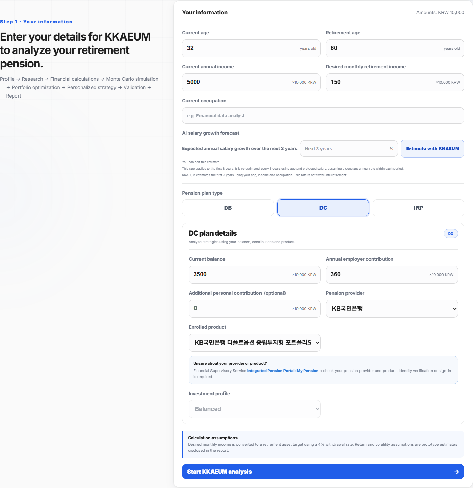
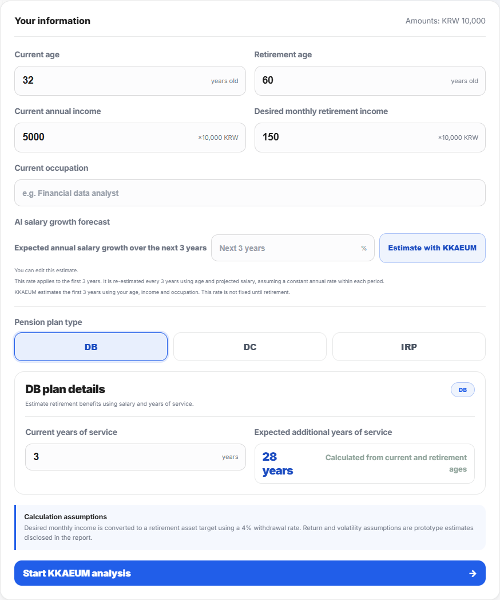
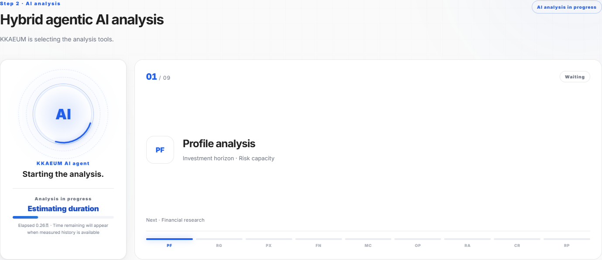
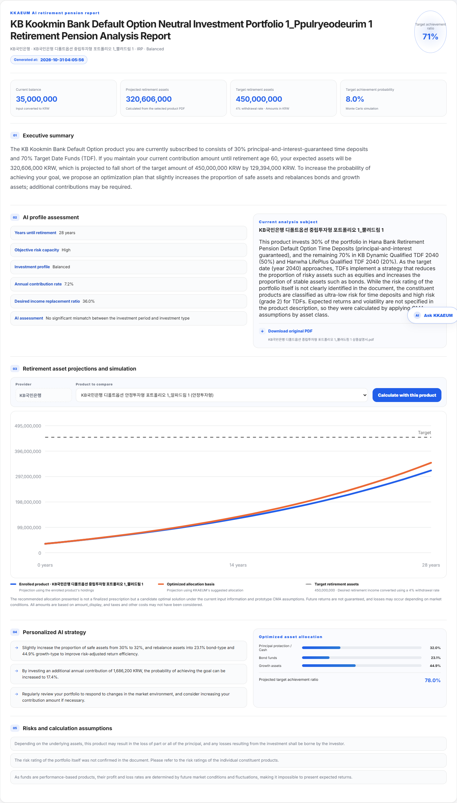
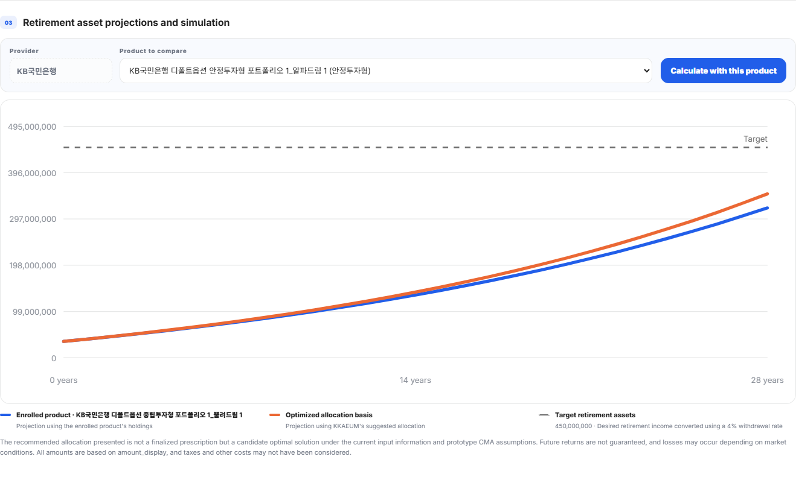
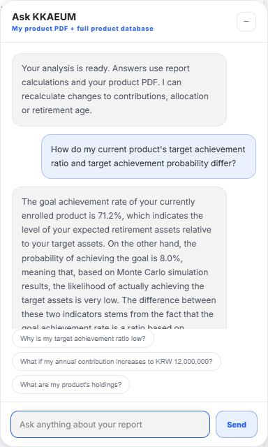
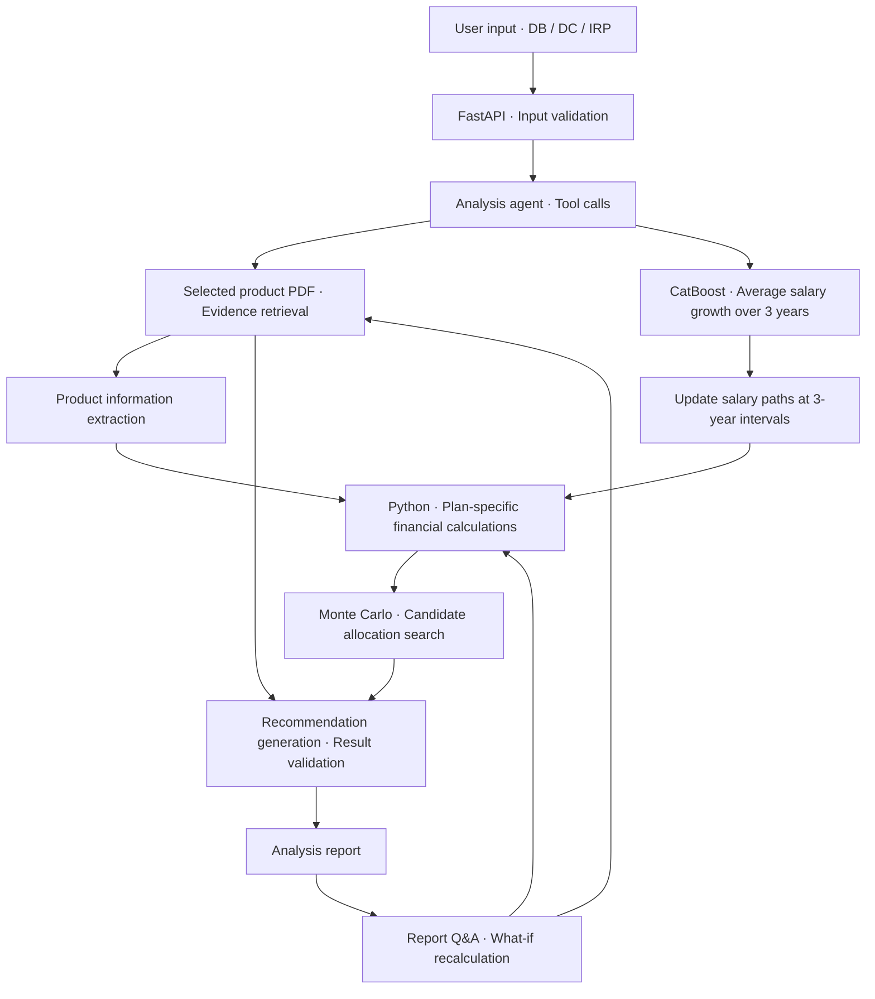

# 깨움(KKAEUM) | AI-Powered Personal Retirement Pension Analysis and Decision Support

This project was submitted to the AI Finance Hackathon hosted by DACON in South Korea.

> A web service that connects evidence from official product documents, personalized salary growth forecasts, and financial simulations to explain pension holdings and retirement asset shortfalls.

**2026 Financial AI Challenge · Team Gijigae (3 members)**  
[Web Demo](https://dacon-ai-finance.vercel.app/) · [GitHub Repository](https://github.com/Heisenberg0607/Dacon_AI_Finance)

## Project Overview

### Problem

Pension participants can find it difficult to understand their product holdings, risks, and retirement asset shortfalls together, even after reading product documents. This project aims to help DC and IRP participants, who choose their own products, review their current plans and assess the effects of changing contributions or asset allocation.

### Approach

We organized 63 official product PDFs from 6 providers into 442 retrieval chunks and connected evidence and portfolio weights from the selected product to the analysis. The FastAPI service integrates KLIPS-based CatBoost salary growth forecasts, Python financial calculations and Monte Carlo simulations, and Qwen-based document interpretation and report generation.

### What You Can Do

Users enter information appropriate to their DB, DC, or IRP plan to view projected retirement assets, shortfalls against their targets, and target achievement probabilities. They can compare other products or allocations, request recalculations under changed assumptions through report Q&A, and view or save the source PDFs and analysis reports.

**My Role:** Designed plan-specific pension analysis logic and long-term asset simulations, handled KLIPS data preprocessing and feature design, and connected salary forecasts to the analysis. Participated in designing and implementing the RAG knowledge base, pension Q&A, and automated reporting modules.

## Key Results and Service Screens

| Category | Verified Result |
| --- | --- |
| Service Flow | User input → Official document analysis → Financial calculations and simulation → Strategy validation → Report and follow-up Q&A |
| Plan Coverage | Distinguishes the benefit, employer contribution, and personal contribution structures of DB, DC, and IRP |
| Document Data | 63 official PDFs, 6 providers, and 442 retrieval chunks |
| Salary Forecasting | RMSE 10.37 pp, MAE 7.10 pp, and R² 0.223 on 6,325 test observations with a 2021 reference year — based on stored model metadata |
| Delivery | Vercel web demo, responsive interface, and Korean, English, and Simplified Chinese UI |

The original production-service screens were captured on 2026-10-30. The report, chart, and Q&A correspond to actual responses under the IRP conditions in the example below.

<details open>
<summary><b>1. User Input — Set Current Assets and Retirement Goals</b></summary>


</details>

<details>
<summary><b>2. DB Plan Input — Switch to Salary- and Service-Based Analysis</b></summary>


</details>

<details>
<summary><b>3. Analysis Progress — Display Server Stage Events and Estimated Waiting Time</b></summary>


</details>

<details open>
<summary><b>4. Analysis Report — Review Assets Against the Target, Product Holdings, and Strategies</b></summary>


</details>

<details>
<summary><b>5. Asset Projections — Compare Paths for the Current Product and a Candidate Allocation</b></summary>


</details>

<details>
<summary><b>6. Report Q&A — Ask Follow-Up Questions Using the Same Calculation Results</b></summary>


</details>

## Individual Contributions

| Area | Work Performed |
| --- | --- |
| Pension Analysis and Asset Simulation | Designed long-term asset forecasting flows that distinguish DB, DC, and IRP accumulation structures and incorporate salary, service years, employer contributions, additional personal contributions, and investment returns |
| KLIPS Data Processing and Forecast Design | Preprocessed data and designed features for predicting salary changes; developed a salary growth forecasting approach that accounts for individual characteristics |
| Connecting Forecasts to Financial Calculations | Designed the analysis flow that connects salary forecasts to DB retirement benefits and changes in DC employer contributions |
| RAG, Q&A, and Reporting | Participated in building the product knowledge base and designing and implementing pension Q&A logic and AI-generated analysis reports |

## Data and Preprocessing

### Official Product Documents

Competition-provided PDFs were parsed into pages and chunks and linked to a catalog containing providers, product names, investment profiles, and file identifiers. Holdings, weights, asset classes, and risk information are extracted from the selected product's document and used as calculation inputs.

Source PDF mappings are managed separately, allowing users to download the product document used in their report.

- [Product Catalog](hybrid_agentic_pension_qwen/data/catalog.json)
- [Retrieval Chunks](hybrid_agentic_pension_qwen/data/chunks.jsonl)
- [Source PDF Mappings](hybrid_agentic_pension_qwen/data/source_pdf_map.json)

### Salary Forecasting Data

We formulated a regression problem using individual year-to-year wage changes in KLIPS to predict average salary growth over the next 3 years. The current service model uses the following three inputs.

| Input | Processing and Role |
| --- | --- |
| Current Salary | Convert annual income entered in the UI to monthly wages, then apply `log1p` |
| Age | Use current age and the updated age at each 3-year interval |
| Occupation | Categorical input mapped to 153 training categories |

The preprocessing recorded in the metadata includes target winsorization using the training data's 1st and 99th percentiles. The prediction target is the **arithmetic mean of the year-on-year simple wage growth rates over the next 3 years (%)**.

```text
Input log monthly wage = log1p(annual income[manwon] / 12)

Target = ((w(t+1)/w(t) - 1)
      + (w(t+2)/w(t+1) - 1)
      + (w(t+3)/w(t+2) - 1)) / 3 × 100
```

## System Architecture and Technology Choices



| Technology or Component | Rationale and Actual Role |
| --- | --- |
| CatBoost | Salary growth regression using occupation categories alongside numerical wage and age inputs; connects three user inputs to the forecasting service |
| Python and NumPy | Explicit implementation of financial formulas and simulations, with input-based random seeds to keep recalculations consistent under the same conditions |
| Qwen Function Calling | Analysis tool selection, structured product information extraction, and explanations and reports combining evidence with calculation results |
| Product-Scoped RAG | Identifies documents by provider and product name before retrieving relevant pages, limiting information from unrelated products |
| Rule-Based Validation and Validation Agent | Check consistency between calculations and recommendations, allocation weights, cited evidence, monetary expressions, and guarantee language |
| FastAPI and Pydantic | Input schema validation and APIs for analysis, product comparison, and Q&A |
| SSE and Browser UI | Communicate actual server-side analysis progress and provide reports, charts, and printing |
| External CatBoost Inference Service | Separates model execution from the Vercel web/API service and connects inference results over HTTP |

Production retrieval currently uses **product metadata + lexical retrieval**. Environments with a prepared embedding index also support a path that incorporates semantic similarity.

### Plan-Specific Calculations

| Plan | Structure Reflected in the Calculations |
| --- | --- |
| DB | Retirement benefits based on projected monthly wages and total service years, and the gap against target assets |
| DC | Current balance, employer contributions proportional to the salary path, additional personal contributions, and product investment returns |
| IRP | Current balance, annual personal contributions, and product investment returns |

Salary paths are reforecast at 3-year intervals using updated age and annual salary. The predicted growth rate is assumed constant within each interval. The architecture supports blending with an age curve; the current deployed artifact assigns CatBoost a weight of 1.0.

The current product's allocation weights come from its official PDF. Future returns and volatility absent from the document are supplemented by asset-class capital market assumptions (CMA) specified in code. The allocation module searches candidates within constraints determined by investment profile and time to retirement.

### Report Q&A and Validation

Q&A calls tools for document retrieval, analysis section lookup, and recalculation under changed assumptions. When applicable conditions such as contributions, retirement age, or safe asset allocation change, the financial engine runs again to compare the scenario against the baseline.

The Python engine performs numerical calculations, while generative AI explains the official documents and calculation results. Responses flagged by rule-based validation are regenerated and checked again; responses include source documents, pages, and tool call traces.

## Evaluation Methods and Results

### Salary Growth Regression Model

The following are fixed-split results stored in the [deployed model metadata](hybrid_agentic_pension_qwen/models/salary_growth/metadata.json). Error is measured in **percentage points (pp)** of average salary growth over 3 years; R² is dimensionless.

| Split | Reference Year | Observations | RMSE(pp) | MAE(pp) | R² |
| --- | --- | ---: | ---: | ---: | ---: |
| Training | 2018 or earlier | 37,741 | 10.1440 | 7.4222 | 0.2470 |
| Validation | 2019–2020 | 11,929 | 10.1965 | 7.0893 | 0.2261 |
| Test | 2021 | 6,325 | 10.3694 | 7.1009 | 0.2229 |

Model outputs receive a bias correction selected through person-group-based 3-fold cross-validation within the validation split. These splits are defined by reference year, and the actual outcome periods for the 3-year targets overlap. This condition should be considered when interpreting the scores.

### Production Service Example

On 2026-10-30, we verified the flow from input through product analysis, report generation, and Q&A in production under the following **IRP demonstration conditions**.

| Input Condition | Value |
| --- | --- |
| Current Age / Retirement Age | 32 / 60 years |
| Current Annual Income | KRW 50,000,000 |
| Current Balance / Annual Personal Contribution | KRW 35,000,000 / KRW 3,600,000 |
| Desired Monthly Retirement Income | KRW 1,500,000 |
| Provider / Investment Profile | KB국민은행 / Balanced |
| Product | KB국민은행 디폴트옵션 중립투자형 포트폴리오 1_뿔려드림 1 |
| Calculation Basis | Allocation weights from the selected product PDF and asset-class CMA assumptions |

| Output Metric | Value | Meaning |
| --- | ---: | --- |
| Target Retirement Assets | KRW 450,000,000 | Desired monthly income × 12 ÷ 4% |
| Projected Retirement Assets | KRW 320,606,000 | Deterministic projection with the current product conditions maintained |
| Shortfall to Target | KRW 129,394,000 | Target assets − Projected assets |
| Target Achievement Ratio | 71.2% | Projected assets ÷ Target assets |
| Target Achievement Probability | 8.0% | Share of 2,500 Monte Carlo simulations that reach or exceed the target |

This scenario illustrates the service flow and calculation results. Retirement asset projections depend on product holdings, contribution conditions, and CMA assumptions, and are distinct from the salary forecasting model's error metrics.

### Functional Verification

- Verified plan-specific input switching, preservation of official product identifiers, report and Q&A generation, and the source PDF download link.
- Verified Korean, English, and Simplified Chinese switching, persistence of the selected language, and absence of horizontal overflow on mobile in production.
- The directly executed unit tests passed: 2 report presentation tests and 9 multilingual processing tests. A separate browser test uses mock APIs to verify the connections among plan switching, reports, product comparison, and Q&A.

## Installation and Running

Start from the repository root. The current web app calls a separate model API for salary forecasts, so local execution requires **two servers: the model server and the web server**.

### 1. Salary Forecasting Model Server

```powershell
git clone https://github.com/Heisenberg0607/Dacon_AI_Finance.git
cd Dacon_AI_Finance
cd salary_growth_model_api
python -m venv .venv
.\.venv\Scripts\Activate.ps1
pip install -r requirements.txt
$env:MODEL_API_KEY = "local-development-key"
uvicorn main:app --reload --port 8001
```

The model file is `salary_growth_model_api/models/catboost_m3.cbm`.

### 2. Web and Analysis Server

Open a new PowerShell window and run the following in the cloned repository's `hybrid_agentic_pension_qwen` directory.

```powershell
python -m venv .venv
.\.venv\Scripts\Activate.ps1
pip install -r requirements.txt
Copy-Item .env.example .env
```

Configure the model API connection and Qwen API key in the generated `.env` file.

```dotenv
APP_MODE=auto
DASHSCOPE_API_KEY=YOUR_DASHSCOPE_API_KEY
SALARY_GROWTH_API_URL=http://127.0.0.1:8001
SALARY_GROWTH_API_KEY=local-development-key
SALARY_GROWTH_API_TIMEOUT_SECONDS=20
```

```powershell
uvicorn app:app --reload
```

Open the [local web app](http://127.0.0.1:8000) in your browser. See the [environment variable example](hybrid_agentic_pension_qwen/.env.example) for Qwen model and endpoint settings, and the [model service documentation](salary_growth_model_api/README.md) for model API configuration.

### 3. Verified Unit Tests

Run these in the web app directory.

```powershell
python -m unittest discover -s tests -p test_report_presentation.py -v
python -m unittest discover -s tests -p test_localization.py -v
```

## Main Directories

```text
Dacon_AI_Finance/
├── hybrid_agentic_pension_qwen/
│   ├── app.py                         # FastAPI endpoints
│   ├── backend/
│   │   ├── agents.py                  # Analysis, recommendation, validation, and reporting flow
│   │   ├── tools.py                   # Financial calculations, simulation, and candidate search
│   │   ├── rag.py                     # Product document retrieval
│   │   ├── product_extractor.py       # Structured product information extraction
│   │   ├── chat_agent.py              # Report Q&A and What-if
│   │   └── guardrails.py              # Expression, unit, and citation checks
│   ├── services/salary_growth/        # Occupation mapping, forecast integration, and salary paths
│   ├── models/salary_growth/          # Model, metadata, and calibration settings
│   ├── data/                         # Catalog, chunks, and source PDF mappings
│   ├── frontend/                     # Input, progress, reports, and multilingual UI
│   ├── scripts/                      # Document corpus and index construction
│   └── tests/                        # Model integration, regression, presentation, and language tests
└── salary_growth_model_api/           # External CatBoost inference service
```

## Limitations and Future Directions

- **Long-Term Salary Paths:** The scenario applies a 3-year forecast as a constant annual growth rate within each interval. Current long-term paths use provisional settings; actual accuracy over 10- and 15-year horizons requires separate long-term observations.
- **Temporal Evaluation Conditions:** Target outcome periods overlap in the fixed split. Strict point-in-time rolling evaluation materials need to be documented alongside these results.
- **Asset Projection Assumptions:** Target assets are calculated using a 4% withdrawal rate, and future returns and volatility depend on CMA assumptions. Extending the treatment of taxes, fees, and other pension income remains a task.
- **Evidence Corpus Coverage:** Current materials focus on product documents. Adding separate regulatory documents for taxation and early withdrawals could broaden the scope of supported questions.
- **Service Integration:** Users currently enter balances and contributions. MyData connectivity and actual account integration are future extensions.
- **Operational State Management:** Analysis sessions are kept in single-process memory for up to 6 hours. Multi-instance operation requires a shared session store.

## Original Materials and Terms of Use

- [Original Repository](https://github.com/Heisenberg0607/Dacon_AI_Finance)
- [Production Web Demo](https://dacon-ai-finance.vercel.app/)
- [Existing Implementation and Configuration Documentation](hybrid_agentic_pension_qwen/README.md)
- [Salary Model Metadata](hybrid_agentic_pension_qwen/models/salary_growth/metadata.json)
- [Salary Path Implementation Notes](hybrid_agentic_pension_qwen/services/salary_growth/PROJECTION.md)
- [Official Korean Labor and Income Panel Study Website](https://www.kli.re.kr/klips/)

Use and disclosure of official product documents and KLIPS materials are subject to each provider's terms. Before using or redistributing code, models, or data, check the repository's and original materials' applicable terms.
