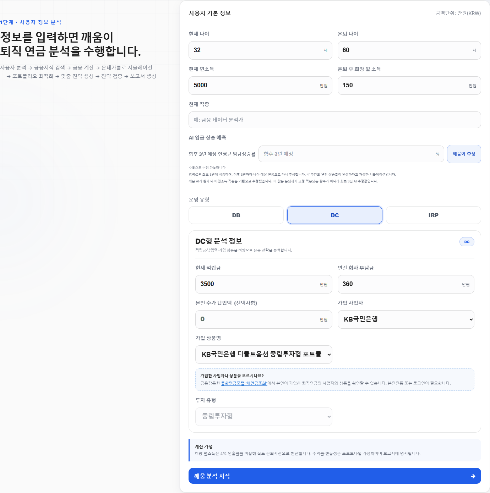
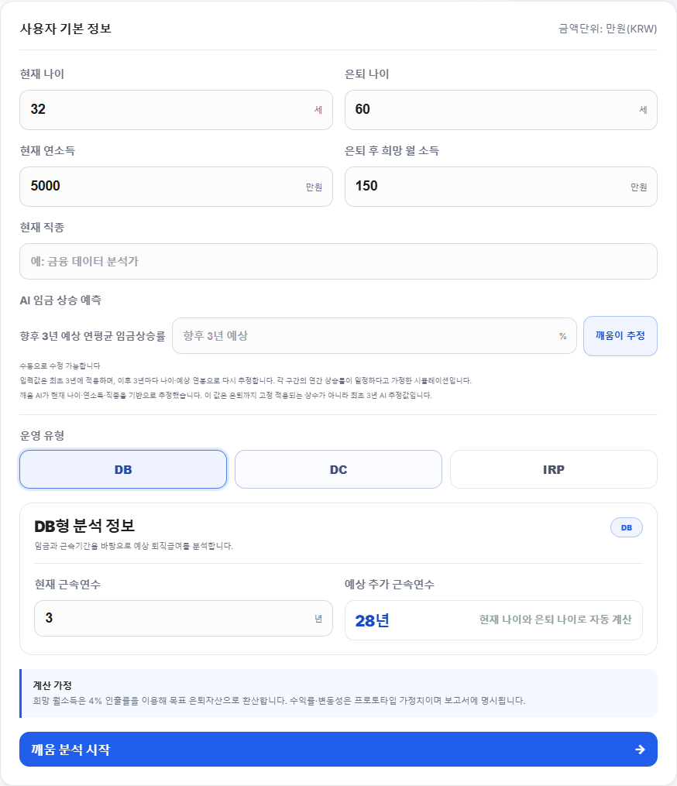
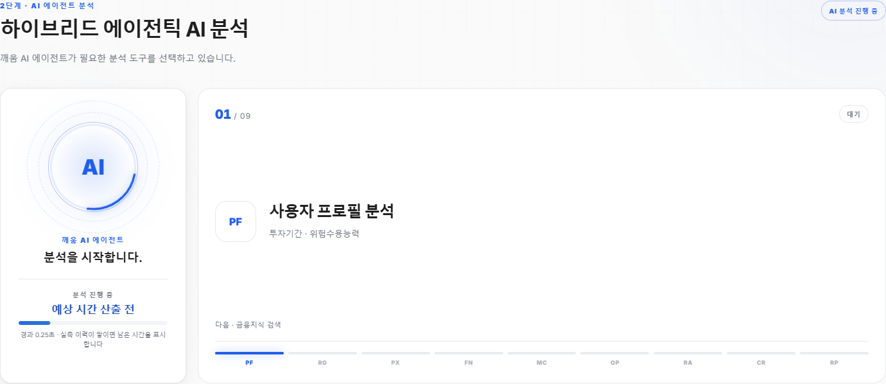
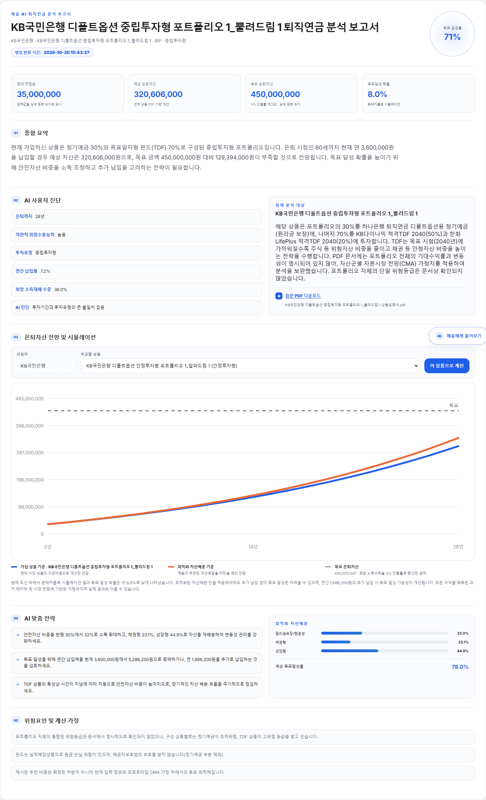
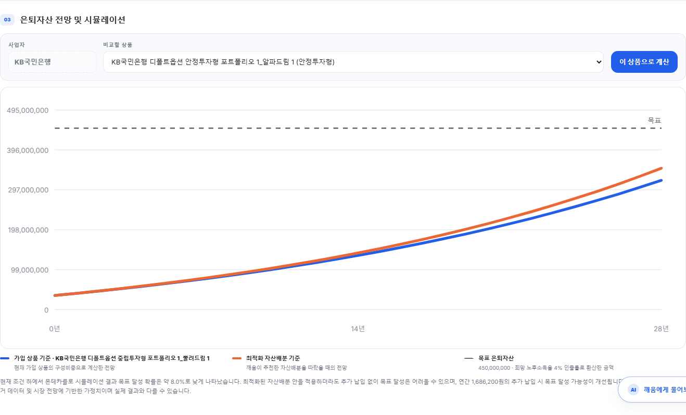
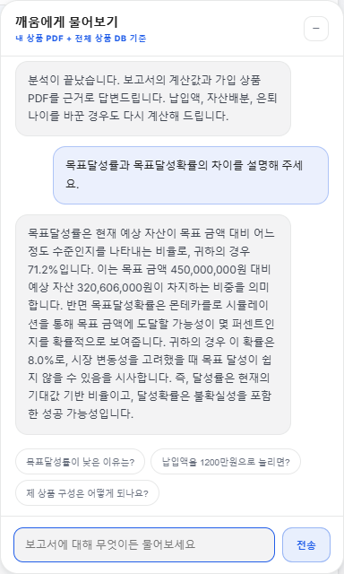
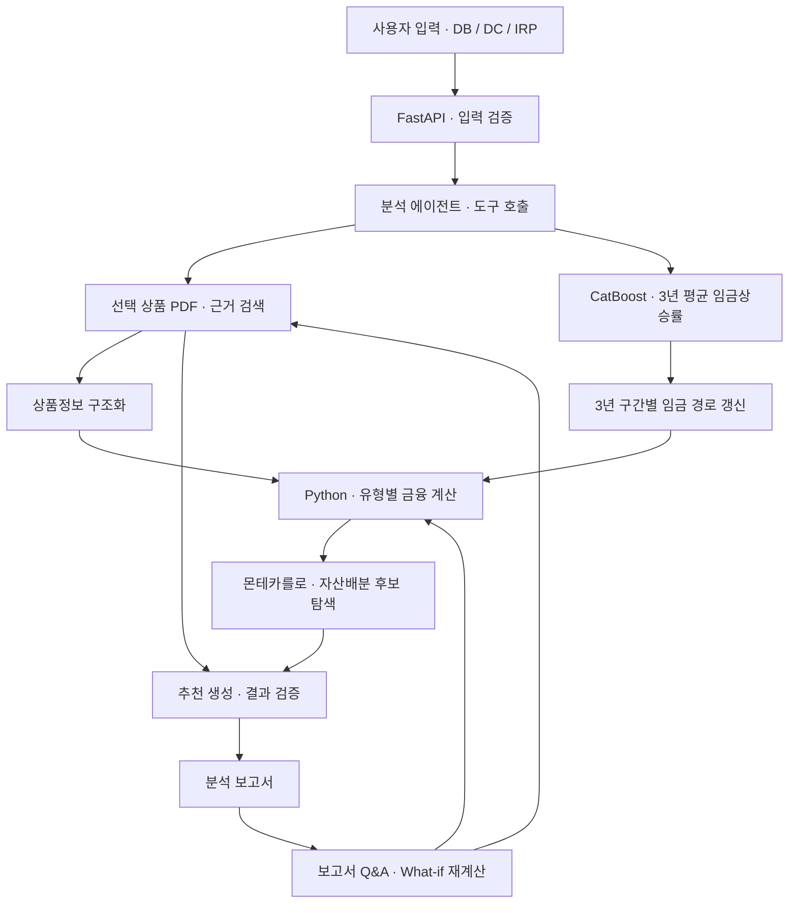

# 깨움(KKAEUM) | AI 기반 개인 퇴직연금 분석·의사결정 지원

본 프로젝트는 DACON에서 개최한 AI 금융 해커톤에 제출한 프로젝트입니다.

> 공식 상품설명서의 근거, 개인별 임금상승률 예측, 금융 시뮬레이션을 연결해 퇴직연금의 구성과 은퇴자산 부족액을 설명하는 웹 서비스입니다.

**2026 금융 AI Challenge · 팀 기지개(3인)**  
[웹 데모](https://dacon-ai-finance.vercel.app/) · [GitHub 저장소](https://github.com/Heisenberg0607/Dacon_AI_Finance)

## 프로젝트 개요

### 문제정의

퇴직연금 가입자는 상품설명서를 읽더라도 자신의 상품 구성과 위험, 은퇴 시점의 자산 부족액을 함께 이해하기 어렵습니다. 특히 직접 상품을 선택하는 DC·IRP 가입자가 현재 상품을 점검하고, 납입액이나 자산배분을 바꿀 때의 차이를 판단할 수 있도록 돕고자 했습니다.

### 해결방법

6개 사업자의 공식 상품설명서 PDF 63종을 442개 검색 청크로 구성하고, 선택한 상품의 근거와 구성비중을 분석에 연결했습니다. 한국노동패널(KLIPS) 기반 CatBoost 임금상승률 예측, Python 금융 계산·몬테카를로 시뮬레이션, Qwen의 문서 해석·보고서 생성을 FastAPI 서비스로 통합했습니다.

### 결과물 활용

사용자는 DB·DC·IRP 유형에 맞는 정보를 입력해 예상 은퇴자산, 목표 대비 부족액과 목표달성 확률을 조회할 수 있습니다. 다른 상품이나 자산배분을 비교하고, 보고서 Q&A에서 조건 변경에 따른 재계산을 요청하며, 분석에 사용한 원문 PDF와 보고서를 확인·보관할 수 있습니다.

**개인 담당:** 유형별 연금 분석 로직과 장기 자산 시뮬레이션 설계, KLIPS 데이터 전처리·특성 설계 및 임금 예측 연계. RAG 지식베이스·연금 Q&A·자동 보고서 모듈 설계와 구현에 참여했습니다.

## 주요 결과와 서비스 화면

| 구분 | 확인된 결과 |
| --- | --- |
| 서비스 흐름 | 사용자 입력 → 공식 문서 분석 → 금융 계산·시뮬레이션 → 전략 검증 → 보고서·후속 Q&A |
| 분석 대상 | DB·DC·IRP의 급여·부담금·개인 납입 구조를 구분 |
| 문서 데이터 | 공식 PDF 63종, 6개 사업자, 검색 청크 442개 |
| 임금 예측 | 2021년 기준 테스트 관측 6,325건에서 RMSE 10.37%p, MAE 7.10%p, R² 0.223 — 저장된 모델 메타데이터 기준 |
| 제공 형태 | Vercel 웹 데모, 반응형 화면, 한국어·영어·중국어 간체 UI |

화면은 2026-10-30 운영 서비스에서 캡처했습니다. 보고서·그래프·Q&A는 아래 실행 예시에 제시한 IRP 조건의 실제 응답입니다.

<details open>
<summary><b>1. 사용자 입력 — 현재 자산과 은퇴 목표 설정</b></summary>


</details>

<details>
<summary><b>2. DB형 입력 — 근속기간과 임금 기반 분석으로 분기</b></summary>


</details>

<details>
<summary><b>3. 분석 진행 — 서버의 단계 이벤트와 예상 대기시간 표시</b></summary>


</details>

<details open>
<summary><b>4. 분석 보고서 — 목표 대비 자산, 상품 구성과 전략을 함께 확인</b></summary>


</details>

<details>
<summary><b>5. 자산 전망 — 현재 상품과 후보 자산배분의 경로 비교</b></summary>


</details>

<details>
<summary><b>6. 보고서 Q&A — 같은 계산 결과를 바탕으로 후속 질문</b></summary>


</details>

## 개인 기여도

| 담당 영역 | 수행 내용 |
| --- | --- |
| 연금 분석·자산 시뮬레이션 | DB·DC·IRP의 적립 구조를 구분하고, 임금·근속기간·회사 부담금·개인 추가 납입·운용수익을 반영하는 장기 자산 예측 흐름 설계 |
| KLIPS 데이터 처리·예측 설계 | 임금 변화 예측을 위한 데이터 전처리와 특성 설계, 개인 특성을 고려한 임금상승률 예측 방안 구성 |
| 예측과 금융 계산의 연결 | 임금 예측 결과를 DB 퇴직급여와 DC 회사 부담금 변화에 연결하는 분석 흐름 설계 |
| RAG·Q&A·보고서 | 상품 지식베이스 구축, 연금 질의응답 로직, AI 자동 분석 보고서 모듈의 설계·구현에 참여 |

## 데이터 및 전처리

### 공식 상품설명서

공모전 제공 PDF를 페이지·청크 단위로 파싱하고, 사업자·상품명·투자유형·파일 식별자를 가진 카탈로그와 연결했습니다. 선택한 상품의 문서에서 구성상품, 비중, 자산군과 위험정보를 추출해 계산 입력으로 사용합니다.

원문 PDF 매핑은 별도 관리하며, 보고서에서 분석에 사용한 상품설명서를 다운로드할 수 있습니다.

- [상품 카탈로그](hybrid_agentic_pension_qwen/data/catalog.json)
- [검색 청크](hybrid_agentic_pension_qwen/data/chunks.jsonl)
- [원문 PDF 매핑](hybrid_agentic_pension_qwen/data/source_pdf_map.json)

### 임금 예측 데이터

KLIPS의 개인별 연도 간 임금 변화로 향후 3년 평균 임금상승률을 예측하는 회귀 문제를 구성했습니다. 현재 서비스 모델의 입력은 다음 세 가지입니다.

| 입력 | 처리 및 역할 |
| --- | --- |
| 현재 임금 | UI의 연소득을 월임금으로 환산한 뒤 `log1p` 변환 |
| 나이 | 현재 연령과 3년 구간별 갱신 연령을 입력 |
| 직종 | 학습 카테고리 153개에 매핑하는 범주형 입력 |

메타데이터에 기록된 전처리는 학습 데이터의 1·99백분위 기준 타깃 윈저라이징을 포함합니다. 예측 타깃은 **향후 3개 연도의 전년 대비 단순 임금상승률 산술평균(%)**입니다.

```text
입력 로그 월임금 = log1p(연소득[만원] / 12)

타깃 = ((w(t+1)/w(t) - 1)
      + (w(t+2)/w(t+1) - 1)
      + (w(t+3)/w(t+2) - 1)) / 3 × 100
```

## 시스템 구조와 기술 선택



| 기술·구성 | 선택 이유와 실제 역할 |
| --- | --- |
| CatBoost | 직종 범주와 수치형 임금·나이를 함께 처리하는 임금상승률 회귀 모델. 사용자 입력 세 가지를 예측 서비스에 연결 |
| Python·NumPy | 금융 수식과 시뮬레이션을 명시적으로 구현하고, 입력 기반 난수 시드로 같은 조건의 재계산 일관성을 확보 |
| Qwen Function Calling | 분석 도구 선택, 상품정보 구조화, 근거와 계산 결과를 결합한 설명·보고서 생성 |
| 상품 범위를 제한한 RAG | 다른 상품의 정보가 섞이지 않도록 사업자·상품명으로 문서를 식별한 뒤 관련 페이지를 검색 |
| 규칙 기반 검증·검증 에이전트 | 계산과 추천 방향, 자산배분 비중, 인용 근거·금액 표현·보장성 문구를 점검 |
| FastAPI·Pydantic | 입력 스키마 검증과 분석·상품 비교·Q&A API 제공 |
| SSE·브라우저 UI | 서버의 실제 분석 단계 진행을 전달하고 보고서·그래프·인쇄 기능 제공 |
| 외부 CatBoost 추론 서비스 | Vercel의 웹/API 서비스와 모델 실행을 분리하고 HTTP로 추론 결과를 연결 |

현재 운영 검색은 **상품 메타데이터 + 어휘 기반 검색**입니다. 임베딩 인덱스를 준비한 환경에서는 의미 유사도를 결합하는 경로를 지원합니다.

### 운영 유형별 계산

| 유형 | 계산에 반영하는 구조 |
| --- | --- |
| DB | 예상 월임금과 총 근속기간에 따른 퇴직급여 및 목표자산과의 차이 |
| DC | 현재 적립금, 임금 경로에 비례한 회사 부담금, 개인 추가 납입액, 상품 운용수익 |
| IRP | 현재 적립금, 개인의 연간 납입액, 상품 운용수익 |

임금 경로는 3년 구간마다 갱신된 나이와 연봉으로 재예측합니다. 각 구간에서는 예측 상승률이 매년 일정하다고 가정합니다. 연령곡선 결합을 지원하는 구조이며, 현재 배포 아티팩트의 결합 가중치는 CatBoost 1.0입니다.

현재 상품의 구성비중은 공식 PDF에서 가져오고, 문서에 없는 미래 수익률·변동성은 코드에 명시한 자산군별 자본시장 가정(CMA)으로 보완합니다. 자산배분 모듈은 투자유형과 은퇴까지의 기간에 따른 제약 안에서 후보를 탐색합니다.

### 보고서 Q&A와 검증

Q&A는 문서 검색, 분석 섹션 조회, 가정 변경 재계산 도구를 호출합니다. 납입액·은퇴 나이·안전자산 비중 등 적용 가능한 조건을 바꾸면 금융 엔진을 다시 실행해 기준 결과와 비교합니다.

숫자 계산은 Python 엔진이 수행하고, 생성형 AI는 공식 문서와 계산 결과를 설명합니다. 규칙 검증에서 문제를 발견한 답변은 재생성을 거쳐 검사하며, 근거 문서·페이지와 도구 호출 이력을 응답에 포함합니다.

## 평가 방법과 결과

### 임금상승률 회귀 모델

아래 값은 [배포 모델 메타데이터](hybrid_agentic_pension_qwen/models/salary_growth/metadata.json)에 저장된 고정 분할 결과입니다. 오차의 단위는 3년 평균 임금상승률에 대한 **퍼센트포인트(%p)**이며, R²는 단위가 없습니다.

| 구분 | 기준 연도 | 관측 수 | RMSE(%p) | MAE(%p) | R² |
| --- | --- | ---: | ---: | ---: | ---: |
| 학습 | 2018년 이하 | 37,741 | 10.1440 | 7.4222 | 0.2470 |
| 검증 | 2019–2020년 | 11,929 | 10.1965 | 7.0893 | 0.2261 |
| 테스트 | 2021년 | 6,325 | 10.3694 | 7.1009 | 0.2229 |

모델 출력에는 검증 구간 내 개인 그룹 기반 3-fold 교차검증으로 선택한 편향 보정을 적용합니다. 위 분할은 기준 연도에 따른 구분으로, 향후 3년 타깃의 실제 관측 기간이 겹치는 조건입니다. 점수 해석 시 이 조건을 함께 고려해야 합니다.

### 실제 서비스 실행 예시

2026-10-30 배포 환경에서 아래 **IRP 시연 조건**으로 입력부터 상품 분석, 보고서와 Q&A 생성까지 확인했습니다.

| 입력 조건 | 값 |
| --- | --- |
| 현재 나이 / 은퇴 나이 | 32세 / 60세 |
| 현재 연소득 | 50,000,000원 |
| 현재 적립금 / 연간 개인 납입액 | 35,000,000원 / 3,600,000원 |
| 희망 은퇴 후 월소득 | 1,500,000원 |
| 사업자 / 투자유형 | KB국민은행 / 중립투자형 |
| 상품 | KB국민은행 디폴트옵션 중립투자형 포트폴리오 1_뿔려드림 1 |
| 계산 기준 | 선택 상품 PDF의 구성비중과 자산군별 CMA 가정 |

| 출력 지표 | 값 | 의미 |
| --- | ---: | --- |
| 목표 은퇴자산 | 450,000,000원 | 희망 월소득 × 12 ÷ 4% |
| 예상 은퇴자산 | 320,606,000원 | 현재 상품 조건을 유지한 결정론적 전망 |
| 목표 대비 부족액 | 129,394,000원 | 목표자산 − 예상자산 |
| 목표달성률 | 71.2% | 예상자산 ÷ 목표자산 |
| 목표달성확률 | 8.0% | 몬테카를로 2,500회 중 목표 이상에 도달한 비율 |

이 예시는 서비스 연결과 계산 결과를 보여주는 시나리오입니다. 은퇴자산 전망은 상품 구성·납입 조건·CMA 가정에 따른 값이며, 임금 예측 모델의 오차 지표와 구분됩니다.

### 기능 검증

- 운영 유형별 입력 전환, 공식 상품 식별자 유지, 보고서·Q&A 생성과 원문 PDF 다운로드 링크를 확인했습니다.
- 한국어·영어·중국어 간체 전환, 선택 언어 저장, 모바일 화면의 가로 넘침을 운영 환경에서 확인했습니다.
- 직접 실행한 단위 테스트는 보고서 표현 2건과 다국어 처리 9건이 통과했습니다. 별도의 브라우저 테스트는 모의 API로 유형 전환·보고서·상품 비교·Q&A의 연결을 확인합니다.

## 설치 및 실행

저장소 루트에서 진행합니다. 현재 웹 앱의 임금 예측은 별도 모델 API를 호출하므로, 로컬 실행은 **모델 서버와 웹 서버 두 개**를 준비합니다.

### 1. 임금 예측 모델 서버

```powershell
git clone https://github.com/Heisenberg0607/Dacon_AI_Finance.git
cd Dacon_AI_Finance
cd salary_growth_model_api
python -m venv .venv
.\.venv\Scripts\Activate.ps1
pip install -r requirements.txt
$env:MODEL_API_KEY = "local-development-key"
uvicorn main:app --reload --port 8001
```

모델 파일은 `salary_growth_model_api/models/catboost_m3.cbm`을 사용합니다.

### 2. 웹·분석 서버

새 PowerShell을 열고 복제한 저장소의 `hybrid_agentic_pension_qwen` 디렉터리에서 실행합니다.

```powershell
python -m venv .venv
.\.venv\Scripts\Activate.ps1
pip install -r requirements.txt
Copy-Item .env.example .env
```

생성된 `.env`에 모델 API 연결과 Qwen API 키를 설정합니다.

```dotenv
APP_MODE=auto
DASHSCOPE_API_KEY=YOUR_DASHSCOPE_API_KEY
SALARY_GROWTH_API_URL=http://127.0.0.1:8001
SALARY_GROWTH_API_KEY=local-development-key
SALARY_GROWTH_API_TIMEOUT_SECONDS=20
```

```powershell
uvicorn app:app --reload
```

브라우저에서 [로컬 웹 앱](http://127.0.0.1:8000)에 접속합니다. Qwen 모델과 엔드포인트의 상세 설정은 [환경변수 예시](hybrid_agentic_pension_qwen/.env.example), 모델 API 설정은 [모델 서비스 문서](salary_growth_model_api/README.md)를 참고합니다.

### 3. 확인한 단위 테스트

웹 앱 디렉터리에서 실행합니다.

```powershell
python -m unittest discover -s tests -p test_report_presentation.py -v
python -m unittest discover -s tests -p test_localization.py -v
```

## 주요 디렉터리

```text
Dacon_AI_Finance/
├── hybrid_agentic_pension_qwen/
│   ├── app.py                         # FastAPI 엔드포인트
│   ├── backend/
│   │   ├── agents.py                  # 분석·추천·검증·보고서 흐름
│   │   ├── tools.py                   # 금융 계산·시뮬레이션·후보 탐색
│   │   ├── rag.py                     # 상품 문서 검색
│   │   ├── product_extractor.py       # 상품정보 구조화
│   │   ├── chat_agent.py              # 보고서 Q&A·What-if
│   │   └── guardrails.py              # 표현·단위·인용 검사
│   ├── services/salary_growth/        # 직종 매핑·예측 연계·임금 경로
│   ├── models/salary_growth/          # 모델·메타데이터·보정 설정
│   ├── data/                         # 카탈로그·청크·원문 PDF 매핑
│   ├── frontend/                     # 입력·진행·보고서·다국어 UI
│   ├── scripts/                      # 문서 코퍼스·인덱스 구축
│   └── tests/                        # 모델 연계·회귀·표현·언어 테스트
└── salary_growth_model_api/           # 외부 CatBoost 추론 서비스
```

## 한계 및 개선 방향

- **장기 임금 경로:** 3년 예측값을 구간별 일정 연간 상승률로 적용하는 시나리오입니다. 현재 장기 경로는 잠정 설정이며, 10·15년 전망의 실제 정확도는 별도 장기 관측을 통해 확인할 과제입니다.
- **평가의 시간 조건:** 고정 분할에서 타깃 관측 기간이 겹칩니다. 엄격한 과거 시점 기준의 rolling 평가 자료를 함께 정리할 필요가 있습니다.
- **자산 전망의 가정:** 목표자산은 4% 인출률로 환산하고, 미래 수익률·변동성은 CMA 가정에 의존합니다. 세금·수수료·다른 연금소득의 반영 범위 확장이 과제입니다.
- **근거 코퍼스 범위:** 현재 자료는 상품설명서 중심입니다. 세제·중도인출 등 별도 규정 문서를 추가해 질의 범위를 넓힐 수 있습니다.
- **서비스 연동:** 현재 적립금과 납입액은 사용자가 입력합니다. 마이데이터 연결과 실제 계좌 연동은 향후 확장 방향입니다.
- **운영 상태 관리:** 분석 세션은 단일 프로세스 메모리에 최대 6시간 보관합니다. 다중 인스턴스 운영에는 공용 세션 저장소 구성이 필요합니다.

## 원본 자료 및 이용 조건

- [원본 저장소](https://github.com/Heisenberg0607/Dacon_AI_Finance)
- [운영 웹 데모](https://dacon-ai-finance.vercel.app/)
- [기존 구현·설정 문서](hybrid_agentic_pension_qwen/README.md)
- [임금 모델 메타데이터](hybrid_agentic_pension_qwen/models/salary_growth/metadata.json)
- [임금 경로 구현 설명](hybrid_agentic_pension_qwen/services/salary_growth/PROJECTION.md)
- [한국노동패널조사 공식 사이트](https://www.kli.re.kr/klips/)

공식 상품설명서와 KLIPS 자료의 이용·공개는 각 제공 기관의 조건을 따릅니다. 코드·모델·데이터의 사용 또는 재배포 시 저장소와 각 원자료의 이용 조건을 확인해야 합니다.
