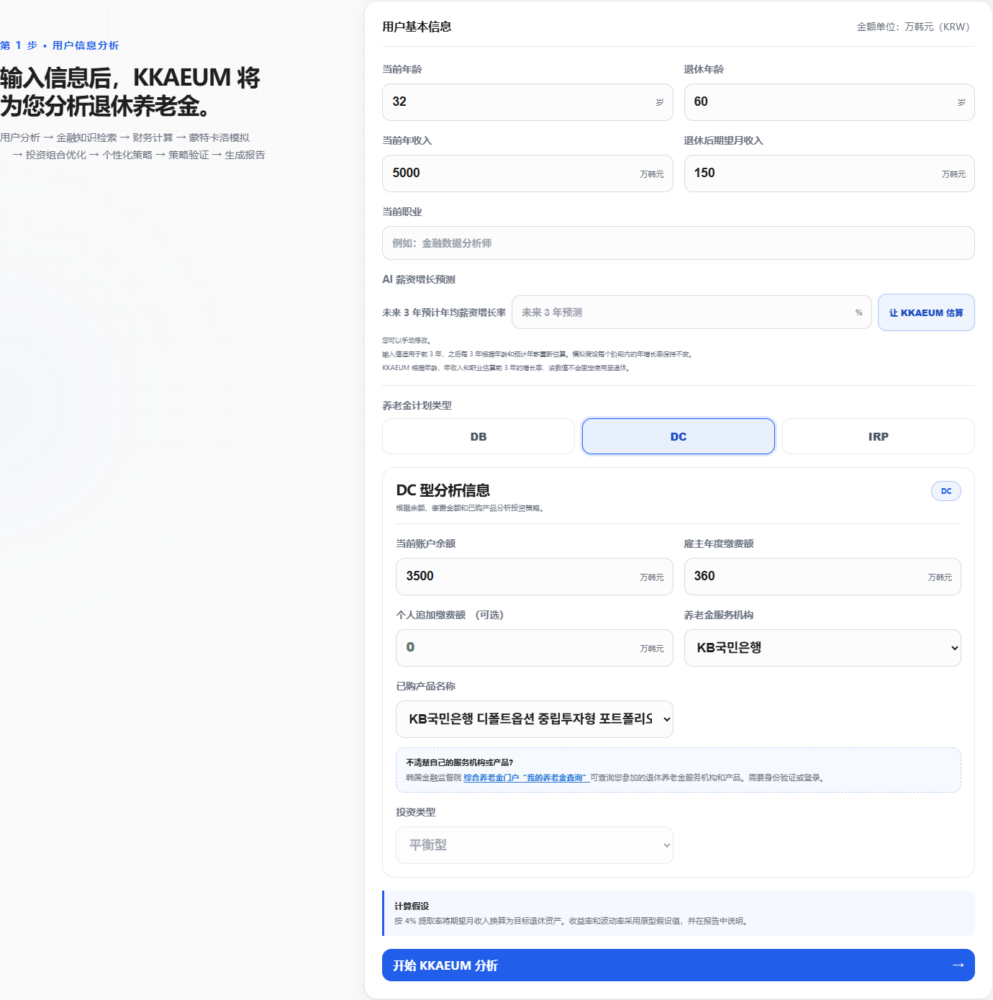
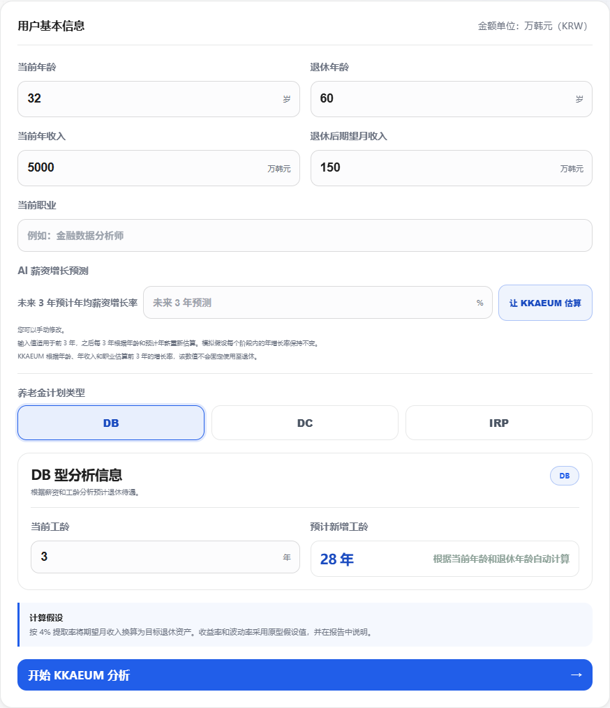
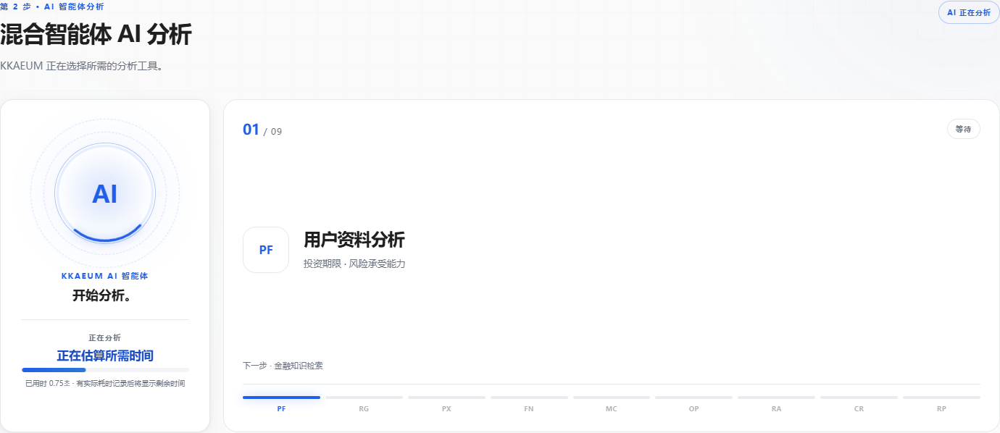
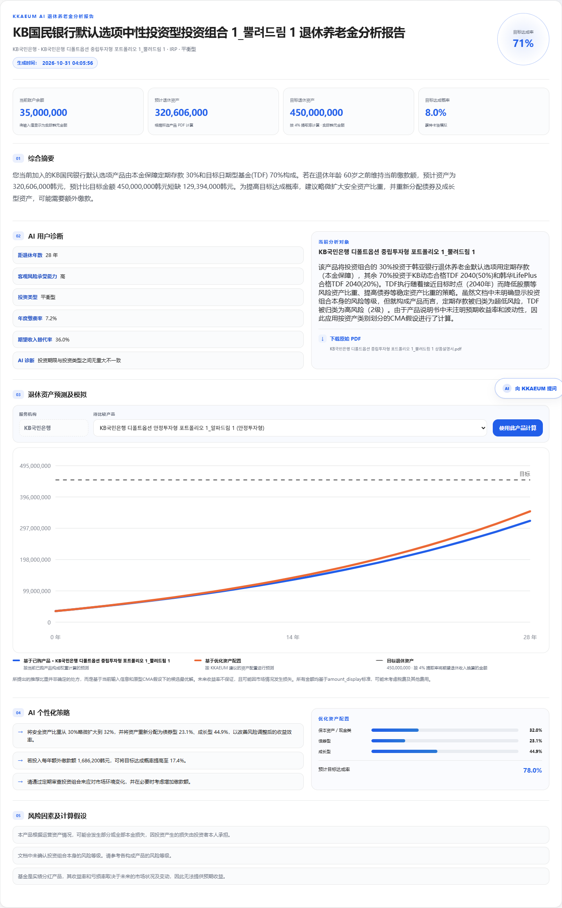
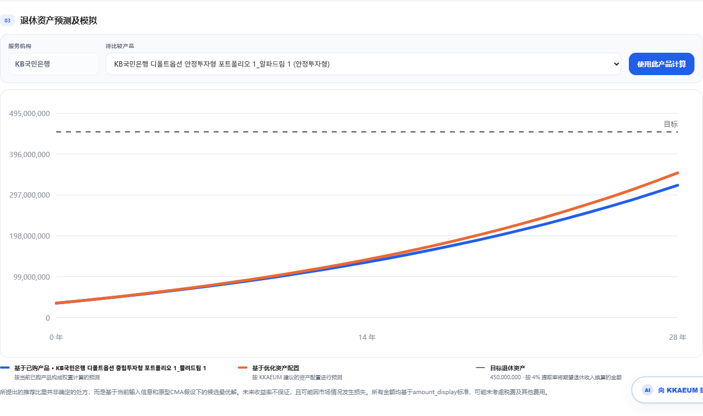
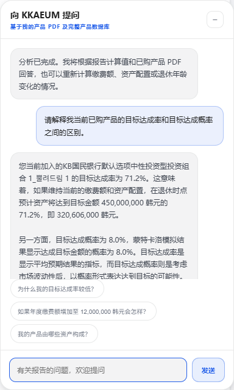
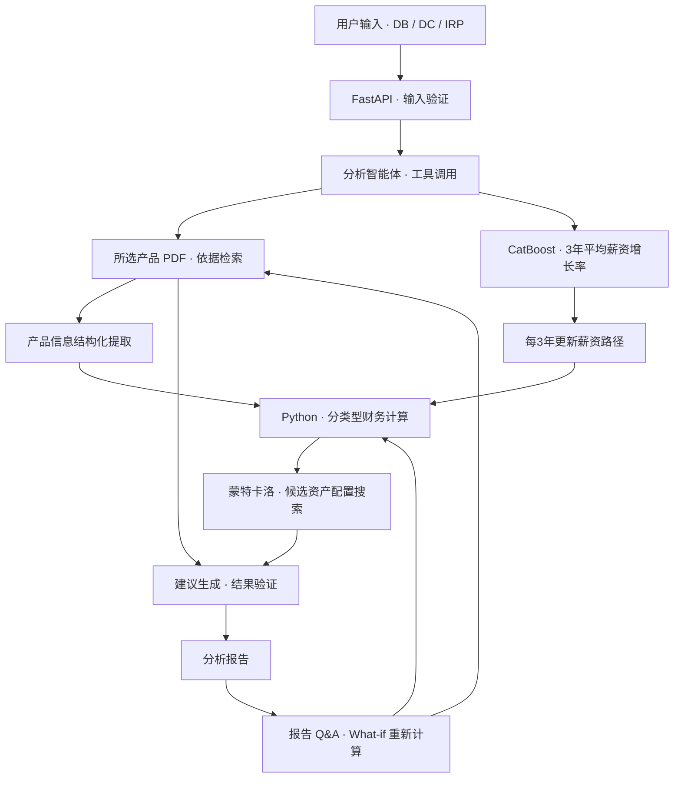

# 깨움(KKAEUM) | 基于 AI 的个人退休养老金分析与决策支持

> 将官方产品说明书依据、个人薪资增长预测与财务模拟相结合，解释养老金资产构成及退休资金缺口的 Web 服务。

**2026 金融 AI Challenge · 기지개团队（3人）**  
[在线演示](https://dacon-ai-finance.vercel.app/) · [GitHub 仓库](https://github.com/Heisenberg0607/Dacon_AI_Finance)

## 项目概述

### 问题定义

养老金参加者即使阅读了产品说明书，也很难同时理解自身产品的资产构成、风险及退休时的资金缺口。本项目旨在帮助需要自行选择产品的 DC、IRP 参加者检查现有产品，并判断调整缴费额或资产配置后会产生怎样的差异。

### 解决方法

将6家服务机构的63份官方产品 PDF 整理为442个检索片段，并将所选产品的依据及配置权重接入分析。通过 FastAPI 服务整合基于韩国劳动与收入面板调查（KLIPS）的 CatBoost 薪资增长预测、Python 财务计算与蒙特卡洛模拟，以及 Qwen 文档解读和报告生成。

### 成果用途

用户可按 DB、DC、IRP 类型输入相应信息，查看预计退休资产、相对目标的资金缺口及目标达成概率。还可比较其他产品或资产配置，在报告 Q&A 中请求按变更条件重新计算，并查看、保存分析所用的原始 PDF 及报告。

**个人负责：** 各养老金类型的分析逻辑与长期资产模拟设计、KLIPS 数据预处理与特征设计，以及薪资预测的衔接。参与 RAG 知识库、养老金 Q&A 和自动报告模块的设计与实现。

## 主要结果与服务画面

| 类别 | 已确认的结果 |
| --- | --- |
| 服务流程 | 用户输入 → 官方文档分析 → 财务计算与模拟 → 策略验证 → 报告与后续 Q&A |
| 分析对象 | 区分 DB、DC、IRP 的待遇、雇主缴费和个人缴费结构 |
| 文档数据 | 63份官方 PDF、6家服务机构、442个检索片段 |
| 薪资预测 | 在基准年份为2021年的6,325条测试观测上，RMSE 为10.37%p、MAE 为7.10%p、R² 为0.223 — 依据已保存的模型元数据 |
| 提供形式 | Vercel 在线演示、响应式界面，以及韩语、英语和简体中文 UI |

原始运营服务画面于2026-10-30截取。报告、图表及 Q&A 对应下方运行示例中 IRP 条件下的实际响应。

<details open>
<summary><b>1. 用户输入 — 设置当前资产与退休目标</b></summary>


</details>

<details>
<summary><b>2. DB 型输入 — 切换至基于工龄和薪资的分析</b></summary>


</details>

<details>
<summary><b>3. 分析进度 — 显示服务器阶段事件与预计等待时间</b></summary>


</details>

<details open>
<summary><b>4. 分析报告 — 同时查看资产与目标的差距、产品构成和策略</b></summary>


</details>

<details>
<summary><b>5. 资产预测 — 比较当前产品与候选资产配置的路径</b></summary>


</details>

<details>
<summary><b>6. 报告 Q&A — 基于相同计算结果进行后续提问</b></summary>


</details>

## 个人贡献

| 负责领域 | 完成的工作 |
| --- | --- |
| 养老金分析与资产模拟 | 区分 DB、DC、IRP 的积累结构，设计纳入薪资、工龄、雇主缴费、个人追加缴费及投资收益的长期资产预测流程 |
| KLIPS 数据处理与预测设计 | 面向薪资变化预测进行数据预处理和特征设计，构建考虑个人特征的薪资增长预测方案 |
| 预测与财务计算的连接 | 设计将薪资预测结果连接至 DB 退休待遇及 DC 雇主缴费变化的分析流程 |
| RAG、Q&A 与报告 | 参与产品知识库构建、养老金问答逻辑及 AI 自动分析报告模块的设计与实现 |

## 数据与预处理

### 官方产品说明书

将比赛提供的 PDF 按页面及片段解析，并连接至包含服务机构、产品名称、投资类型和文件标识符的目录。从所选产品的文档中提取构成产品、权重、资产类别及风险信息，作为计算输入。

原始 PDF 映射单独管理，用户可在报告中下载分析所用的产品说明书。

- [产品目录](hybrid_agentic_pension_qwen/data/catalog.json)
- [检索片段](hybrid_agentic_pension_qwen/data/chunks.jsonl)
- [原始 PDF 映射](hybrid_agentic_pension_qwen/data/source_pdf_map.json)

### 薪资预测数据

利用 KLIPS 中个人逐年薪资变化，构建预测未来3年平均薪资增长率的回归任务。当前服务模型采用以下三个输入。

| 输入 | 处理方式与作用 |
| --- | --- |
| 当前薪资 | 将 UI 中输入的年收入换算为月薪后，进行 `log1p` 变换 |
| 年龄 | 输入当前年龄及每个3年阶段更新后的年龄 |
| 职业 | 映射至153个训练类别的类别型输入 |

元数据记录的预处理包括按训练数据第1和第99百分位阈值对目标进行缩尾处理。预测目标为**未来3个年度同比简单薪资增长率的算术平均值（%）**。

```text
输入对数月薪 = log1p(年收入[万韩元] / 12)

目标 = ((w(t+1)/w(t) - 1)
      + (w(t+2)/w(t+1) - 1)
      + (w(t+3)/w(t+2) - 1)) / 3 × 100
```

## 系统架构与技术选择



| 技术或组件 | 选择理由与实际作用 |
| --- | --- |
| CatBoost | 同时处理职业类别和数值型薪资、年龄的薪资增长回归模型，将三个用户输入连接至预测服务 |
| Python 与 NumPy | 显式实现财务公式和模拟，使用基于输入的随机种子，保持相同条件下重新计算的一致性 |
| Qwen Function Calling | 选择分析工具、结构化提取产品信息，并结合依据和计算结果生成说明与报告 |
| 限定产品范围的 RAG | 先通过服务机构和产品名称识别文档，再检索相关页面，减少其他产品信息的混入 |
| 规则验证与验证智能体 | 检查计算与建议方向、资产配置权重、引用依据、金额表达及保证性用语 |
| FastAPI 与 Pydantic | 验证输入 schema，提供分析、产品比较和 Q&A API |
| SSE 与浏览器 UI | 传递服务器实际分析阶段进度，提供报告、图表及打印功能 |
| 外部 CatBoost 推理服务 | 将模型运行与 Vercel Web/API 服务分离，通过 HTTP 连接推理结果 |

当前运营检索采用**产品元数据 + 词汇检索**。在准备了嵌入索引的环境中，支持结合语义相似度的检索路径。

### 按养老金类型计算

| 类型 | 计算中反映的结构 |
| --- | --- |
| DB | 根据预计月薪与总工龄计算退休待遇，以及与目标资产的差额 |
| DC | 当前余额、随薪资路径变化的雇主缴费、个人追加缴费及产品投资收益 |
| IRP | 当前余额、个人年度缴费额及产品投资收益 |

每3年使用更新后的年龄和年薪重新预测薪资路径，并假设每个阶段内的预测增长率保持不变。系统支持与年龄曲线结合；当前部署产物中 CatBoost 的结合权重为1.0。

当前产品的配置权重取自官方 PDF，文档中缺少的未来收益率和波动率由代码中明确指定的分资产类别资本市场假设（CMA）补充。资产配置模块在由投资类型及距退休期限确定的约束范围内搜索候选方案。

### 报告 Q&A 与验证

Q&A 调用文档检索、分析部分查询和条件变更重新计算工具。当缴费额、退休年龄、安全资产占比等适用条件变化时，财务引擎重新运行，并与基准结果比较。

数值计算由 Python 引擎执行，生成式 AI 负责解释官方文档和计算结果。规则验证发现问题的回答会重新生成并再次检查；响应中包含依据文档、页面及工具调用记录。

## 评估方法与结果

### 薪资增长率回归模型

以下为[部署模型元数据](hybrid_agentic_pension_qwen/models/salary_growth/metadata.json)中保存的固定划分结果。误差单位是3年平均薪资增长率的**百分点（%p）**，R² 无单位。

| 划分 | 基准年份 | 观测数 | RMSE(%p) | MAE(%p) | R² |
| --- | --- | ---: | ---: | ---: | ---: |
| 训练 | 2018年及以前 | 37,741 | 10.1440 | 7.4222 | 0.2470 |
| 验证 | 2019–2020年 | 11,929 | 10.1965 | 7.0893 | 0.2261 |
| 测试 | 2021年 | 6,325 | 10.3694 | 7.1009 | 0.2229 |

模型输出采用在验证集内通过按个人分组的3-fold交叉验证选择的偏差校正。上述划分按基准年份区分，未来3年目标的实际观测期间存在重叠，解释分数时应结合这一条件。

### 实际服务运行示例

2026-10-30，在部署环境中，按以下 **IRP 演示条件**确认了从输入、产品分析到报告和 Q&A 生成的流程。

| 输入条件 | 数值 |
| --- | --- |
| 当前年龄 / 退休年龄 | 32岁 / 60岁 |
| 当前年收入 | 50,000,000韩元 |
| 当前余额 / 个人年度缴费额 | 35,000,000韩元 / 3,600,000韩元 |
| 期望退休后月收入 | 1,500,000韩元 |
| 服务机构 / 投资类型 | KB국민은행 / 平衡型 |
| 产品 | KB국민은행 디폴트옵션 중립투자형 포트폴리오 1_뿔려드림 1 |
| 计算依据 | 所选产品 PDF 中的配置权重与分资产类别 CMA 假设 |

| 输出指标 | 数值 | 含义 |
| --- | ---: | --- |
| 目标退休资产 | 450,000,000韩元 | 期望月收入 × 12 ÷ 4% |
| 预计退休资产 | 320,606,000韩元 | 保持当前产品条件的确定性预测 |
| 距目标的资金缺口 | 129,394,000韩元 | 目标资产 − 预计资产 |
| 目标达成率 | 71.2% | 预计资产 ÷ 目标资产 |
| 目标达成概率 | 8.0% | 2,500次蒙特卡洛模拟中达到或超过目标的比例 |

此示例是展示服务流程和计算结果的情景。退休资产预测取决于产品构成、缴费条件和 CMA 假设，应与薪资预测模型的误差指标区分。

### 功能验证

- 确认了按养老金类型切换输入、保留官方产品标识符、生成报告与 Q&A，以及原始 PDF 下载链接。
- 在运营环境中确认了韩语、英语、简体中文切换、语言选择保存及移动端无横向溢出。
- 直接执行的单元测试中，报告呈现2项与多语言处理9项均通过。另有浏览器测试使用模拟 API，验证类型切换、报告、产品比较及 Q&A 之间的衔接。

## 安装与运行

从仓库根目录开始。当前 Web 应用的薪资预测调用独立模型 API，因此本地运行需要准备**模型服务器与 Web 服务器两个服务**。

### 1. 薪资预测模型服务器

```powershell
git clone https://github.com/Heisenberg0607/Dacon_AI_Finance.git
cd Dacon_AI_Finance
cd salary_growth_model_api
python -m venv .venv
.\.venv\Scripts\Activate.ps1
pip install -r requirements.txt
$env:MODEL_API_KEY = "local-development-key"
uvicorn main:app --reload --port 8001
```

模型文件使用 `salary_growth_model_api/models/catboost_m3.cbm`。

### 2. Web 与分析服务器

新开一个 PowerShell 窗口，在已克隆仓库的 `hybrid_agentic_pension_qwen` 目录中运行。

```powershell
python -m venv .venv
.\.venv\Scripts\Activate.ps1
pip install -r requirements.txt
Copy-Item .env.example .env
```

在生成的 `.env` 中设置模型 API 连接与 Qwen API 密钥。

```dotenv
APP_MODE=auto
DASHSCOPE_API_KEY=YOUR_DASHSCOPE_API_KEY
SALARY_GROWTH_API_URL=http://127.0.0.1:8001
SALARY_GROWTH_API_KEY=local-development-key
SALARY_GROWTH_API_TIMEOUT_SECONDS=20
```

```powershell
uvicorn app:app --reload
```

在浏览器中打开[本地 Web 应用](http://127.0.0.1:8000)。Qwen 模型及端点的详细设置参见[环境变量示例](hybrid_agentic_pension_qwen/.env.example)，模型 API 设置参见[模型服务文档](salary_growth_model_api/README.md)。

### 3. 已确认的单元测试

在 Web 应用目录中运行。

```powershell
python -m unittest discover -s tests -p test_report_presentation.py -v
python -m unittest discover -s tests -p test_localization.py -v
```

## 主要目录

```text
Dacon_AI_Finance/
├── hybrid_agentic_pension_qwen/
│   ├── app.py                         # FastAPI 端点
│   ├── backend/
│   │   ├── agents.py                  # 分析、建议、验证与报告流程
│   │   ├── tools.py                   # 财务计算、模拟与候选搜索
│   │   ├── rag.py                     # 产品文档检索
│   │   ├── product_extractor.py       # 产品信息结构化提取
│   │   ├── chat_agent.py              # 报告 Q&A 与 What-if
│   │   └── guardrails.py              # 表达、单位与引用检查
│   ├── services/salary_growth/        # 职业映射、预测衔接与薪资路径
│   ├── models/salary_growth/          # 模型、元数据与校正设置
│   ├── data/                         # 目录、片段与原始 PDF 映射
│   ├── frontend/                     # 输入、进度、报告与多语言 UI
│   ├── scripts/                      # 文档语料与索引构建
│   └── tests/                        # 模型衔接、回归、呈现与语言测试
└── salary_growth_model_api/           # 外部 CatBoost 推理服务
```

## 局限与改进方向

- **长期薪资路径：** 将3年预测值作为各阶段内不变的年度增长率应用于情景计算。当前长期路径采用暂定设置，10年、15年预测的实际准确度需要通过独立的长期观测进一步确认。
- **评估的时间条件：** 固定划分中目标观测期间存在重叠，需要同时整理严格基于历史时点的 rolling 评估资料。
- **资产预测假设：** 目标资产按4%提取率换算，未来收益率与波动率依赖 CMA 假设。税费及其他养老金收入的纳入范围仍需扩展。
- **依据语料范围：** 当前资料以产品说明书为主，可通过增加税制、提前提取等独立法规文档扩展可回答的问题范围。
- **服务连接：** 当前余额和缴费额由用户输入。MyData 连接及实际账户对接是后续扩展方向。
- **运行状态管理：** 分析会话在单进程内存中最多保留6小时。多实例运行需要配置共享会话存储。

## 原始资料与使用条件

- [原始仓库](https://github.com/Heisenberg0607/Dacon_AI_Finance)
- [运营 Web 演示](https://dacon-ai-finance.vercel.app/)
- [现有实现与配置文档](hybrid_agentic_pension_qwen/README.md)
- [薪资模型元数据](hybrid_agentic_pension_qwen/models/salary_growth/metadata.json)
- [薪资路径实现说明](hybrid_agentic_pension_qwen/services/salary_growth/PROJECTION.md)
- [韩国劳动与收入面板调查官方网站](https://www.kli.re.kr/klips/)

官方产品说明书与 KLIPS 资料的使用和公开遵循各提供机构的条件。使用或再分发代码、模型及数据时，应确认仓库和各原始资料的适用条件。
